

  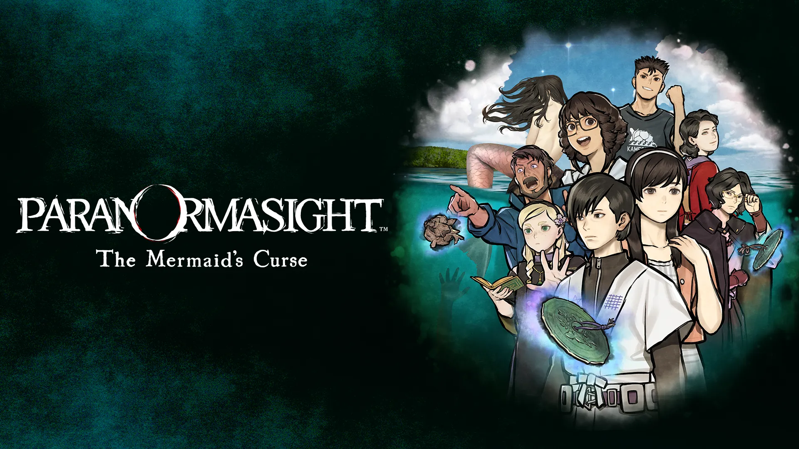

<h1 align="center">파라노마사이트 FILE38: 이세 인어 이야기 한글 패치</h1>

  PARANORMASIGHT: The Mermaid's Curse · パラノマサイト FILE38 伊勢人魚物語 
  비공식 한국어 번역 패치 · 한글 패치 제작 <b>SAKURA</b>

  

  <a href="#진행-현황">진행 현황</a> ·
  <a href="#지원-환경">지원 환경</a> ·
  <a href="#설치와-사용">설치와 사용</a> ·
  <a href="#번역-기준">번역 기준</a> ·
  <a href="#문제-제보">문제 제보</a> ·
  <a href="#저작권과-고지">저작권과 고지</a>

> [!TIP]
> ### ✅ 텍스트 14,156행 전부 번역·검수 완료
> **본편 · 선택지 · 자료/머리글 · 인물 · 차트 · 미니게임 · 엔딩 · 극장** 등 게임 안 텍스트 **14,156행**과 스태프 크레디트 **433행**을 하나도 빠짐없이 번역하고, 모두 일본어 원문과 대조해 검수했습니다. 진행에 필요한 그림 속 글자(**핵심 이미지 14종**)도 한글화와 검수를 마쳤습니다.

> [!NOTE]
> ### 🙏 번역에 대한 부탁
> 일본어 원문을 하나하나 확인하고 자연스러운 한국어로 다듬었지만, 그래도 부족한 부분이 있을 수 있습니다. 너그러운 양해 부탁드립니다.
> **오역이나 어색한 표현, 더 나은 번역이 떠오르면 언제든 적극적으로 제보해 주세요.** 보내 주신 의견은 하나하나 확인하겠습니다.
> → [소개 페이지 제보 폼](https://deuxdoom.github.io/GameKoreanPatch/#report) · [GitHub Issues](https://github.com/deuxdoom/GameKoreanPatch/issues/new)

> [!IMPORTANT]
> **아직 공개 배포판이 없습니다.** 번역·검수와 글꼴 적용을 마쳤고, 한국어 키보드 입력도 실제 게임에서 확인했습니다. 지금은 최종 빌드와 전체 플레이 확인을 준비하는 단계입니다. 시험판은 제작자가 직접 화면을 확인하는 용도로만 쓰고 있으며 내려받을 수 없습니다. 배포판을 공개하면 이 문서와 저장소의 Releases에 함께 안내합니다.

## 소개

『파라노마사이트 FILE38: 이세 인어 이야기』는 스퀘어 에닉스의 미스터리 어드벤처 게임입니다. 198x년 여름, 미에현 이세만에 떠 있는 외딴섬 카메시마를 무대로 인어 전설과 섬을 덮친 저주를 쫓아갑니다. 2026년 2월 19일에 Nintendo Switch, PC(Steam), iOS, Android로 출시되었으며, 정식 한국어는 지원하지 않습니다.

이 패치는 일본어 원문을 기준으로 게임 안의 대사, 선택지, 자료, 메뉴, 인물 소개, 스태프 크레디트를 한국어로 옮깁니다. 게임의 일본어 언어 설정 자리에 한국어가 표시되는 방식입니다.

## 원작 소개

원작 공식 사이트의 줄거리, 등장인물, 제작 스태프 소개를 한국어로 옮겼습니다. 제목을 누르면 펼쳐집니다.

<b>줄거리</b>

 

무대는 미에현 이세시마 지방. 
<b>불로불사</b>를 가져다준다는 인어의 수수께끼를 둘러싸고 
여름 외딴섬에서 펼쳐지는 군상극 전기(傳奇) 미스터리. 
등장인물 저마다의 속셈이 얽히고설키며 
이윽고 수백 년의 역사를 넘나드는 인어의 저주를 둘러싼 
<b>경악할 드라마</b>로 이어져 간다.

<b>등장인물</b>

 

| 인물 | 소개 |
|---|---|
| 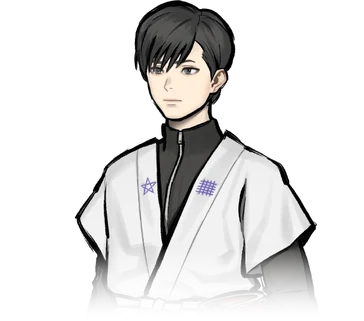 **미나구치 유자** 水口 勇佐 · Yuza Minakuchi | 카메시마에 사는, 성실하면서도 마이페이스인 소년. 은퇴한 할머니의 뒤를 이어 해녀 일을 시작했다. 5년 전 해난 사고로 부모님을 잃었고, 그때 어떤 신비한 일을 겪었다. |
| 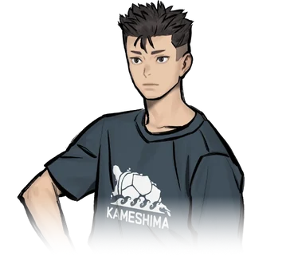 **쿠모이 아자미** 雲居 アザミ · Azami Kumoi | 미나구치 유자의 소꿉친구이자 단짝. 세상을 떠난 아버지의 어선을 물려받아 어부로 일한다. 남을 잘 챙겨 주변에서 의지하는 타입으로, 고향 사랑만큼은 누구보다 강하다고 자부한다. |
| 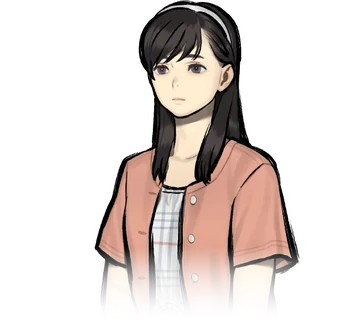 **시라나미 사토** 白浪 里 · Sato Shiranami | 몇 달 전 카메시마에 흘러들어 온 수수께끼의 소녀. 기억을 잃은 것 같은데……. |
|  **아와오 츠카사** 沫緒 つかさ · Tsukasa Awao | 카메시마에서 나고 자란 밝고 활발한 소녀. 지금은 고등학교에 다니려고 본토에서 하숙하고 있다. 미나구치 유자, 쿠모이 아자미와는 소꿉친구. 고향에 내려온 동안 시라나미 사토와 친해졌다. |
|  **아르나브 바넘** アルナーヴ・バーナム · Arnav Barnum | 낭만을 찾아 일본에 온 미국인. 본업은 판타지 작가 겸 오컬트 라이터. 아무래도 이세시마에서 인어를 찾고 있는 모양이다. 애칭은 ‘아비’. 40세. 독신. |
| 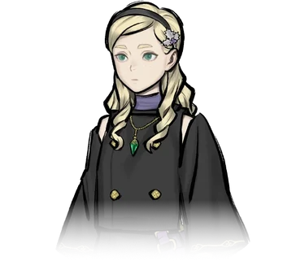 **키르케 루나라이트** キルケ・ルナーライト · Circe Lunarlight | 《엑소시스트》 소녀. 영국 명문가 출신으로 일본에 유학 중이다. 일본의 전승과 오컬트에 밝아, 친척인 아비의 부탁으로 가이드를 맡고 있다. |
| 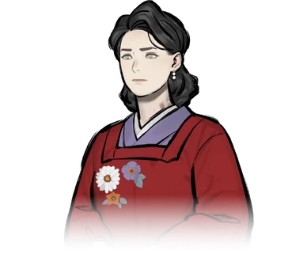 **시키 유메코** 志貴 結命子 · Yumeko Shiki | 자칭 도쿄의 주부. 무언가를 조사하고 있는 모양인데……. |
| 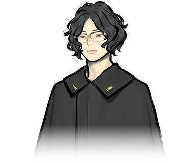 **키류 소도** 霧生 双奴 · Sodo Kiryu | 시키 유메코의 조수로 일하는 청년. 범상치 않은 분위기를 풍긴다. |

<b>제작 스태프</b>

 

| 담당 | 이름 | 주요 참여작 |
|---|---|---|
| 디렉터 / 시나리오 | **이시야마 타카나리** 石山貴也 | 「스쿨걸 스트라이커즈」, 「파라노마사이트 FILE23 혼조 칠대 불가사의」 등 |
| 캐릭터 디자인 | **코바야시 겐** 小林 元 | 「스쿨걸 스트라이커즈」, 「파라노마사이트 FILE23 혼조 칠대 불가사의」 등 |
| 사운드 컴포저 | **이와사키 히데노리** 岩﨑英則 | 「파이널 판타지 크리스탈 크로니클 크리스탈 베어러」, 「파라노마사이트 FILE23 혼조 칠대 불가사의」 등 |

출처: [원작 공식 사이트(일본어)](https://www.jp.square-enix.com/paranormasight/file38/)의 소개 문구를 한국어로 옮겼습니다. © SQUARE ENIX

## 적용 화면

개발 중인 시험판에서 찍은 화면입니다. 배포판에서는 글꼴과 표현이 달라질 수 있습니다. 이미지를 누르면 크게 볼 수 있습니다.

  <a href="assets/paranormasight2/screens/title.webp">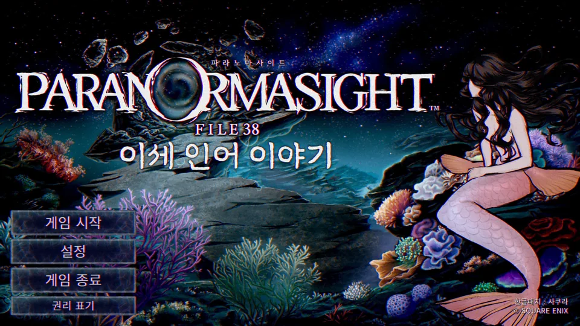</a> 
  타이틀 화면

| **설정 · 언어 설정** | **카메시마 지도** |
|---|---|
| <a href="assets/paranormasight2/screens/settings.webp">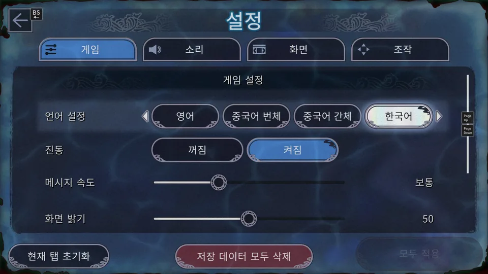</a> | <a href="assets/paranormasight2/screens/map.webp">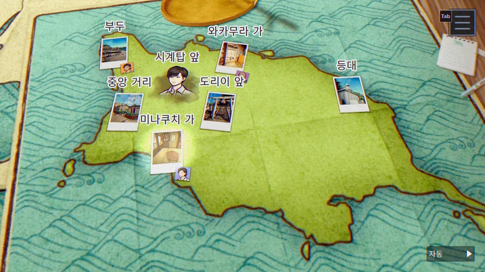</a> |
| **인물 목록** | **자료 · 카메시마 남해의 대재난** |
| <a href="assets/paranormasight2/screens/characters.webp">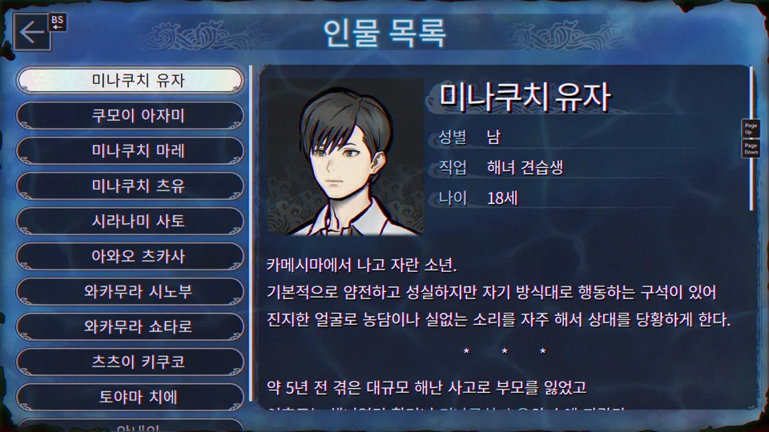</a> | <a href="assets/paranormasight2/screens/document-disaster.webp">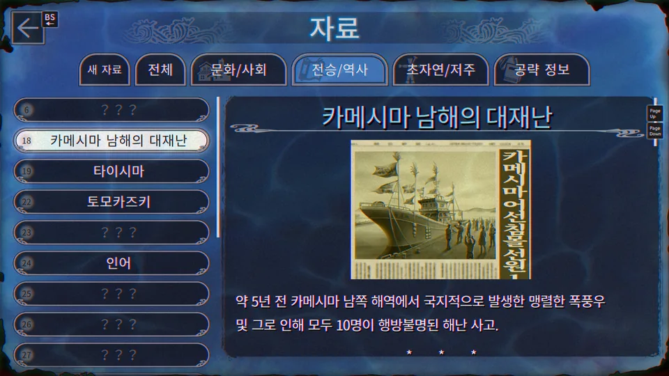</a> |
| **자료 · 카메시마루** | **자료 · 동화 『우라시마 타로』** |
| <a href="assets/paranormasight2/screens/document-kamessy.webp">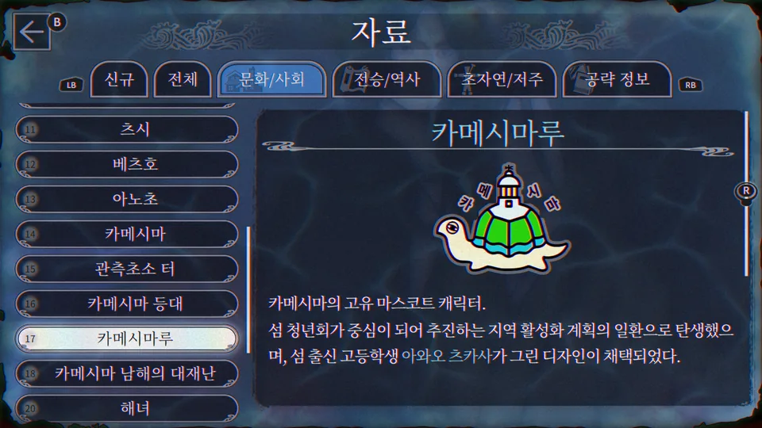</a> | <a href="assets/paranormasight2/screens/document-urashima.webp">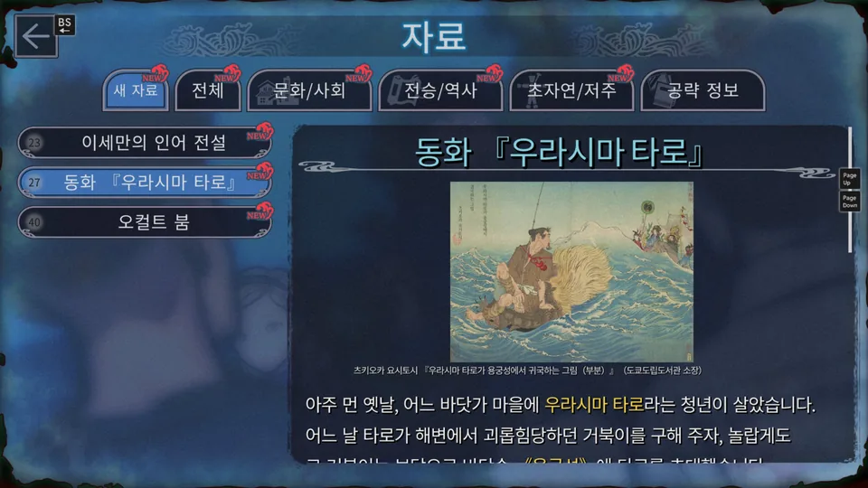</a> |
| **대화 장면** | **인물 등장 · 와카무라 시노부** |
| <a href="assets/paranormasight2/screens/dialogue.webp">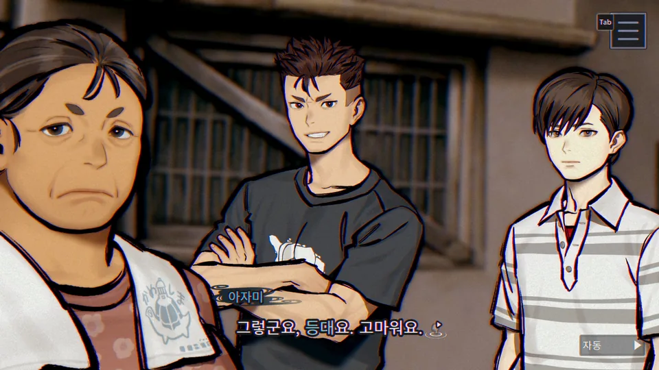</a> | <a href="assets/paranormasight2/screens/intro-shinobu.webp">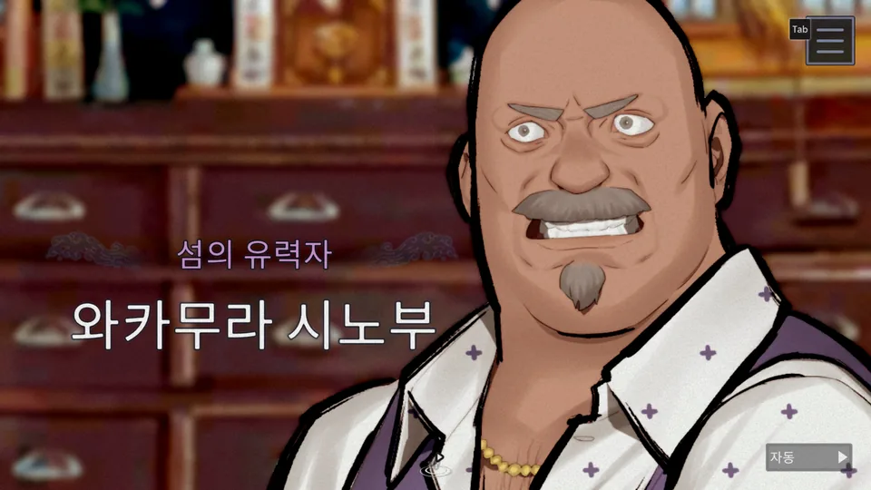</a> |

  <a href="assets/paranormasight2/screens/warning.webp">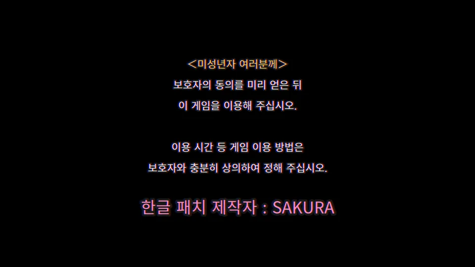</a> 
  시작 안내 · 한글 패치 제작자 표기

## 진행 현황

| 단계 | 상태 | 내용 |
|---|---|---|
| 번역 | ✅ **전부 완료** | 본편·선택지·자료/머리글·인물·차트·미니게임·엔딩·극장 등 **14,156행 전체**, 별도 스태프 크레디트 433행 |
| 일괄 검수·수정 | ✅ **전부 완료** | 전체 행을 일본어 원문과 대조해 오역, 인물별 호칭·말투, 고유명사 표기, 단서·숫자·제어문 점검 |
| 이미지 한글화 | ✅ **완료** | 진행에 필요한 타이틀·안내·자료의 핵심 이미지 14종 한글화·검수, 인물 소개 이름 19곳 |
| 한국어 입력 | ✅ **완료** | 이름·단서 입력 8곳에 한국어 정답 35개 연결, 실제 게임에서 한국어 키보드 입력 확인 |
| 글꼴 결정 | ✅ **완료** | 대사·메뉴, 인물 이름, 자료, 타이틀별 글꼴 확정 |
| 최종 빌드·실행 확인 | ⬜ 대기 | 전체 플레이 확인과 보고된 문제 수정 |
| 배포용 설치 프로그램 | ⬜ 대기 | 원본 게임 파일을 포함하지 않는 차분 패치 |

## 지원 환경

- **Windows용 Steam판만 지원합니다** (Steam AppID `2701440`).
- 지금까지 확인한 Steam 빌드는 `22496791`입니다. 배포판을 공개할 때 지원하는 빌드와 파일 해시를 함께 공지합니다.
- Nintendo Switch, iOS, Android판과 Steam 이외의 PC판은 지원하지 않습니다.
- 게임을 정상적으로 구매해 설치한 상태여야 합니다. 이 저장소와 배포판은 원본 게임 파일을 포함하지 않습니다.

## 설치와 사용

배포판은 Windows용 설치 프로그램으로 제공할 예정입니다. 설치 프로그램에는 다음 기능을 넣습니다.

- Steam 설치 위치 자동 검색과 게임 폴더 직접 선택
- 지원하는 게임 판본인지 파일 해시로 확인
- 바꾸기 전 원본 파일 백업, 설치 실패 시 자동 복구
- 패치 제거(백업해 둔 원본으로 되돌리기)

### 한국어로 표시하기

이 패치는 게임의 일본어 자리에 한국어를 표시합니다. 설치한 뒤 Steam에서 게임 언어를 일본어로 맞춰 주세요.

1. Steam 라이브러리에서 게임을 마우스 오른쪽 버튼으로 누르고 **속성**을 엽니다.
2. 왼쪽 메뉴에서 **일반**을 고릅니다.
3. **언어**를 **日本語(일본어)** 로 바꾼 뒤 게임을 실행합니다.

  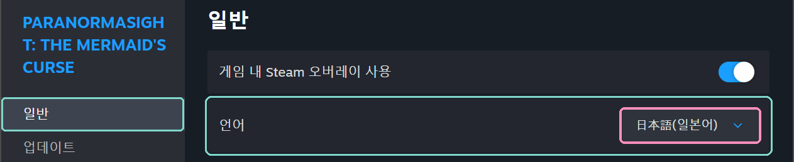

> [!NOTE]
> Steam의 **게임 파일 무결성 확인**이나 게임 업데이트가 패치한 파일을 원래대로 되돌릴 수 있습니다. 게임이 업데이트되면 새 판본을 지원하는 패치가 나올 때까지 기다려 주세요.

## 번역 기준

- **일본어 원문이 기준입니다.** 영어판은 문맥을 확인하는 참고 자료로만 썼습니다.
- **고유명사**는 한국 게임·애니메이션에서 널리 쓰는 표기를 따릅니다(카메시마, 츠카사, 타이라노 토모시게 등). 도쿄처럼 이미 굳은 표기와 공식 명칭은 그대로 씁니다.
- **호칭과 존댓말**은 인물 소개에 나온 나이와 관계에 맞췄습니다. 예를 들어 츠카사는 유자와 아자미를 `오빠`라고 부릅니다.
- **연도와 숫자**는 `5년 전`처럼 아라비아 숫자로 씁니다.
- **이미지**는 제목·안내·조작·퍼즐 단서처럼 진행에 필요한 글자만 한글화했습니다. 그림의 장식, 낙관, 작은 옛 글씨는 원화 그대로 둡니다.
- 스태프 크레디트는 업무명과 일본어 이름을 한국어로 옮기고, 아래쪽 영문 이름은 그대로 둡니다.
- 시작 화면의 저작권 주의 문구 아래에 `한글 패치 제작자 : SAKURA`를 표시합니다.

주요 용어

| 원문 | 한국어 | 비고 |
|---|---|---|
| 亀島 | 카메시마 | 작품의 무대가 되는 섬 |
| 八百比丘尼 | 야오비쿠니 | 공식 명칭을 따름 |
| なめどり | 양아치 새 | 새들의 불량배 무리. 개별 새 이름은 한국어 말장난으로 옮김 |
| 素潜り漁 | 물질 / 잠수 어로 | 대사는 `물질`, 미니게임·자료 화면은 `잠수 어로` |
| トモカヅキ | 토모카즈키 | 이세·시마 지역 해녀 전승 |
| 呪主 | 저주인 | |

## 알려진 제한

- 그림 속 작은 글씨와 장식 문자는 원문 그대로 남아 있습니다.

## 문제 제보

오역, 어색한 표현, 글자 잘림, 진행 문제는 [소개 페이지의 제보 폼](https://deuxdoom.github.io/GameKoreanPatch/#report)이나 [GitHub Issues](https://github.com/deuxdoom/GameKoreanPatch/issues/new)에 남겨 주세요. 제보하려면 GitHub 로그인이 필요합니다. 다음 내용을 함께 적어 주시면 빠르게 확인할 수 있습니다.

- 문제가 나온 장면과 바로 전에 한 조작
- 화면 스크린샷(이슈 본문에 끌어다 놓거나 붙여 넣기)

## 글꼴

패치에 쓰는 글꼴입니다. 글꼴 원본은 수정하지 않았습니다.

| 글꼴 | 쓰는 곳 | 라이선스 |
|---|---|---|
| Noto Sans CJK KR | 대사·메뉴 등 기본 본문 | SIL Open Font License 1.1 (© Adobe) |
| Noto Serif CJK KR | 자료 화면 글, 자료 그림 속 문구 | SIL Open Font License 1.1 (© Adobe) |
| Pretendard | 시작 화면 저작권 주의 문구 | SIL Open Font License 1.1 |
| 마루 부리 (MaruBuri) | 인물 이름, 작은 타이틀 | SIL Open Font License 1.1 (© NAVER Corp.) |
| 조선100년체 | 큰 타이틀(이미지로 그림) | 방일영문화재단 무료 글꼴 (수정·판매 금지) |

배포판에는 각 글꼴의 라이선스 원문을 함께 넣습니다.

## 저작권과 고지

- 『PARANORMASIGHT: The Mermaid's Curse』와 이 문서에 쓴 키 아트·로고, 게임 안의 모든 텍스트·이미지의 권리는 SQUARE ENIX에 있습니다. © SQUARE ENIX
- SQUARE ENIX and the SQUARE ENIX logo are trademarks or registered trademarks of Square Enix Holdings Co., Ltd.
- 이 패치는 개인이 만든 **비공식 팬 번역**이며 SQUARE ENIX와 관계가 없습니다. 패치 사용에 따른 문제는 SQUARE ENIX에 문의하지 말아 주세요.
- 이 저장소에는 원본 게임 파일과 게임에서 추출한 데이터를 올리지 않습니다. 키 아트와 로고는 패치를 소개하는 용도로만 쓰며, 권리자가 요청하면 바로 내립니다.

원작 공식 사이트: [PARANORMASIGHT FILE38 (일본어)](https://www.jp.square-enix.com/paranormasight/file38/) · Steam 스토어: [PARANORMASIGHT: The Mermaid's Curse](https://store.steampowered.com/app/2701440/PARANORMASIGHT_The_Mermaids_Curse/)

한글 패치 제작 · <b>SAKURA</b>

